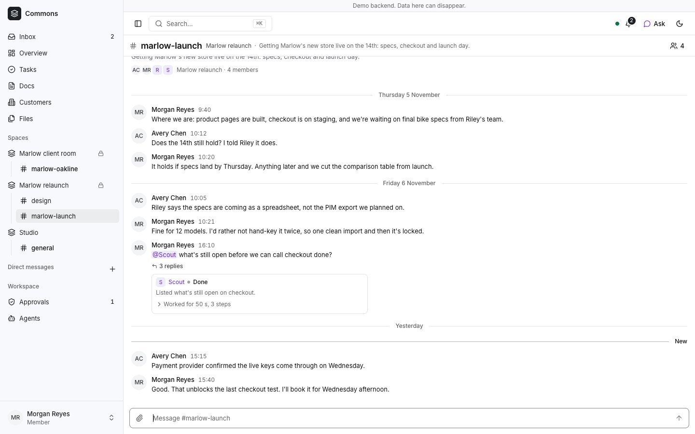

# Commons

Chat, tasks, docs, customers and files for a small team, with AI agents that work as members and ask before they act.

**Starter template**

`39 tables · 186 endpoints · 15 screens · auth: @xano-sdk/auth`



Commons is Xano's flagship team workspace. A small team can trial it with real work: talk in channels and DMs, run tasks on a board, write docs together, keep track of customers, and share files. Agents are members too. They have a name, a sponsor and the same access rules as a person, and anything a guest would see waits for a person to approve it.

It is a template to learn from and build on. It doesn't replace Slack or Linear, and the [limits](#limits) say what it leaves out.

The backend under [`xano/`](xano/) is TypeScript, written with the [Xano SDK](https://github.com/xano-sdk/sdk). It runs on your machine as the Xano Engine, and on Xano's cloud with the same command. The React frontend under [`frontend/`](frontend/) takes its request paths and types from the backend.

## Quick start

```sh
git clone https://github.com/xano-community/commons-team-workspace
cd commons-team-workspace
npm install
```

Then run it one of two ways:

- **On your machine, no account.** `npm run xano:deploy` deploys and seeds the backend on the Xano Engine on your machine. Then `npm run dev` opens the app.
- **On a cloud link** (works with ChatGPT and Claude). Run `npx @xano/sdk login` once, then `npm run xano:deploy:ephemeral`. It prints a live URL.

Then click **Continue as Morgan Reyes**. You need no model key for the demo.

The demo is a small design studio, relaunching the website of a client called Marlow Cycles:

| Persona | Role | Who they are |
|---|---|---|
| **Morgan Reyes** | member | Leads the relaunch. Scout has a draft waiting for her |
| **Avery Chen** | admin | Runs the studio, and sees every space |
| **Riley Park** | guest | The client, who sees only the client room |
| **Scout** | agent, hosted | Keeps the relaunch moving. Runs on Xano when someone asks |
| **Relay** | agent, connected | Morgan's assistant on her own machine, such as Claude Code |

## What you can do

**As Morgan, the first minute:**

1. You land in your inbox. Scout wants to reply in the client room, and the card shows the exact words, and that Riley, a guest, will read them. It is marked **Sample run**: it was seeded, not made by a model.
2. Change a word and press **Approve**. The reply appears as "Scout · approved by Morgan", and the run finishes.
3. Open **Customers**, then **Marlow Cycles**. Its page links to chat, tasks, docs and files about it. Follow a link to a task, and from the task to a doc.
4. Open the user menu and choose **Open as Avery in a new window**. Send a message in one window and watch it arrive in the other.
5. Assign a task to Scout. Its run shows at once, waiting for a model key, with the exact command to add one.

**Also try:** press ⌘K and search for "checkout". Mention a doc in a channel where someone can't open it, and see the warning. Sign in as Riley and see only the client room. Invite a teammate from **Team** with a one-time link.

## Agents

There are two kinds of agent member. Both use the same 11 tools under the same rules.

### Hosted agents

A hosted agent, such as Scout, runs on Xano. Mention it, message it, or assign it a task. A chip shows its state at once, it posts its progress in the thread, and its result lands in your inbox. Anyone who can see the record can press **Stop**.

Hosted agents need a model key. Until there is one, their work waits, and the chip says so. Anthropic is the default (`claude-opus-5-5`). Set the key on the running backend, with no redeploy:

```sh
printf %s "$KEY" | npx @xano/sdk env set ANTHROPIC_API_KEY
```

Waiting runs start within a minute. To use Google instead, set `AGENT_PROVIDER` to `google-genai` and set `GEMINI_API_KEY`. `ANTHROPIC_MODEL` and `GEMINI_MODEL` pick the model. A key you want to keep through a replacing deploy also goes in `xano/.env`, which git ignores. `AGENT_RUN_SLOTS` says how many runs go at once: 1 on the Engine, 2 on a cloud deploy.

### Connected agents: connect Claude Code

A connected agent, such as Relay, runs somewhere else and works here under its own name. To connect Claude Code as Relay:

1. Sign in as Avery, an admin. Open **Team**, then **Relay**. Morgan, Relay's sponsor, can do the same from Relay's page, which opens from its name anywhere in the app.
2. Press **Make a key**. Choose what it can do and how long it lasts: 7, 30 or 90 days. The key shows once.
3. Copy the **Connect Claude Code** command and run it in a terminal. In Claude Code, type `/mcp` to see it connected.
4. Ask Claude Code to check its inbox and do the work there.

Any MCP client works with the server address and the key as a Bearer token. To add your own agent, an admin presses **Add agent** on **Team**. Revoke a key on the agent's page, where you can also see what it did.

### ChatGPT and Claude on the web

ChatGPT and Claude on the web and desktop sign in as a person, not as an agent member. Their work shows as "Morgan via ChatGPT", and they reach only the spaces and DMs that person has joined, even if the person is an admin. They reach customers if the person can. Sign-in needs `MCP_OAUTH_LOGIN_URL` on a cloud deploy (see [Going to production](#going-to-production)). The Engine on your machine doesn't serve it.

### The tools

| Tool | Read or write | What it does |
|---|---|---|
| `my_inbox` | read | What's waiting for the agent: mentions, assignments, replies, decisions |
| `search` | read | Records matching some words, among the ones it may open |
| `read_record` | read | A conversation, task, project, doc, customer or file, with its recent history |
| `post_message` | write | Say something in a conversation |
| `save_task` | write | Add or change a task |
| `save_doc` | write | Start a doc, or suggest a change to one |
| `save_crm_record` | write | Add or change a company, contact or deal |
| `save_file` | write | Save text as a file people can open |
| `report_progress` | write | Post progress in the run's thread, and say when it's done |
| `request_action` | write | Ask a person first: delete, bulk change, export, join a space, change a role, send a DM |
| `check_approval` | read | How a request ended |

An agent writes freely where only the team can read. Anything a guest would see waits for a person: the card shows the exact words, who outside the team will read them, and **Approve**, **Edit** and **Decline**. What goes out shows the agent as author and the person as approver.

| What an agent wants | Who decides |
|---|---|
| Anything a guest would see, a delete, or more than 20 tasks at once | Its sponsor, or the admins if the sponsor can't reach the record |
| Exporting customers, joining a space, changing a role | Any admin |

A connection can make 60 changes every 5 minutes. A run started from a DM stays in that DM. The build refuses more than 12 tools (`xano/agents/tool-limit.ts`), so a new record type extends a tool's input instead of adding a tool.

## Built in

- **Overview.** The home screen: what needs you, what your agents are working on, and recent activity in your spaces. Each number opens the list behind it.
- **Live updates.** A change by a person or an agent shows on every open screen, with no reload. Docs and records show who else is there.
- **Inbox.** Mentions, assignments, replies and approvals, grouped by record, with keyboard moves (`J`, `K`, `E`).
- **Links.** Type `#` to link a task, doc, customer or channel. Each link shows to each viewer as they may see it: a title, "No access", or "Deleted".
- **⌘K.** Jump to any screen, run any command, or search across all five tools.
- **The assistant.** **Ask** in the header answers from the workspace's data.
- **Invites and resets.** An admin invites people by role, as a one-time link. No mail service is needed.
- **Settings.** The workspace name, time zone, week start, and the demo controls.

### How each tool works

- **Chat.** Channels live in spaces. DMs are read only by their members, admins included. A message sent twice by a flaky network arrives once.
- **Tasks.** List and board views, projects inside spaces, saved filters, and a thread on every task.
- **Docs.** Docs live in spaces and keep a history you can restore. Everyone in a doc sees who else is there, and a save reaches their screens within a moment. Two people can't type in one doc at the same time: if two saves cross, the second person is asked what to keep, and nothing is lost. Agents never write into a doc directly. They file a suggestion, with **Apply** and **Dismiss**, that never moves your cursor.
- **Customers.** Companies, contacts, deals on a pipeline board, and notes. Anyone with `crm.read` reaches all of it, whichever spaces they're in, and guests don't. Deals use one currency: change `CURRENCY` in `frontend/src/lib/crm/model.ts`.
- **Files.** One flat list per space, with type and date filters. Drop, paste or pick a file. Images, PDFs and text preview in the app, and HTML and SVG only download. Settings says where this deployment keeps file bytes:

  | Mode | Where the bytes are | Largest file | How they're read |
  |---|---|---|---|
  | Private storage (cloud) | A private bucket | 25 MB | A 60-second signed link |
  | In the database (the Engine) | `file_blob` | 5 MB | A signed-in route |

  Change the limits with `TABLE_LIMIT` and `SIGNED_LIMIT` in `xano/function/files/files.ts`.
- **Trash.** Deleted tasks, docs, customers and files stay in the trash for 30 days.

## How access works

The template starts from [`@xano-sdk/auth`](https://github.com/xano-sdk/auth), ejected into owned source, so the user table, roles and demo sign-in are the app's to edit.

| Role | Can | Cannot |
|---|---|---|
| `admin` | Everything: manage the team, see every space in a browser, change the pipeline | Read DMs they're not in |
| `member` | Make spaces, work in the spaces they join, open customers | Manage the team, see spaces they haven't joined |
| `guest` | Work in the spaces they're invited to | Open customers, use the assistant, see the team |
| `agent` | What its spaces and its tools allow, with a person as its sponsor | Hold any other role, or reach a space it hasn't joined |

One rule decides who reaches a record, in `xano/function/access/reach.ts`. Every endpoint, agent tool, search, inbox read and live channel asks it. Identity comes from the signed-in token, never from the request. Access is checked at the API layer, not with row-level security. A record you can't reach answers "Not found", so nobody can tell it from one that doesn't exist. A link between records never changes who reaches either one.

Permissions live in one map ([`@xano-sdk/rbac`](https://github.com/xano-sdk/rbac), `xano/rbac.ts`). Admins change roles under **Team**, and every change is recorded. Removing the last admin, or yourself, is refused.

## API surface

Every route needs a signed-in token, except sign-in itself and the two listed in `xano/public-endpoints.json`, each with its reason. `npx @xano/sdk routes ./xano/index.ts` lists all 186.

| Group | Routes | What it covers | What it enforces |
|---|---|---|---|
| `api:authn` | 15 | Sign-in, sign-up, demo sign-in, first-admin setup, invites, resets | Demo doors close when demo mode ends. Setup needs `SETUP_TOKEN` |
| `api:spaces`, `api:members` | 17 | Spaces, who's in them, removing people, ending the demo | Only managers and admins change a space |
| `api:messaging` | 10 | Channels, DMs, threads, messages, read positions | DMs for their members only. A retried send lands once |
| `api:tasks` | 18 | Tasks, projects, saved views | The space rule. Guests add only where the space allows |
| `api:docs`, `api:doc-tools` | 17 | Docs, versions, suggestions | The space rule. An archived space is read-only |
| `api:crm` | 34 | Companies, contacts, deals, notes, stages | `crm.read` to open, admins for stages |
| `api:files` | 12 | Uploads, downloads, attachments | The record's own rule, checked on every download |
| `api:links`, `api:search` | 7 | Links, mention checks, search, the overview | Results and counts only from what you reach |
| `api:agents`, `api:agent`, `api:agent-loop`, `api:approvals` | 33 | Agents, keys, runs, approvals | Sponsors and admins manage agents. Approvers decide |
| `api:mcp-oauth-team-workspace` | 4 | The ChatGPT and Claude sign-in page | The person's own reach |

The rest are the base app's: the assistant, notifications, settings, activity and live changes.

## Repo layout

The app's own files:

- `xano/app.ts` (name, roles, demo people and agents), `xano/rbac.ts` (permissions), `xano/approvals.ts` (what asks first), `xano/agent.ts` (the MCP server).
- `xano/domain.ts` lists everything of the app's own. Tables are in `xano/table/`, logic in `xano/function/`, routes in `xano/query/`, and agent tools and the runner in `xano/agents/`. Workflow tests are in `xano/test/`. The demo world is `xano/world.ts`, and `xano/production.ts` is the same backend with no seed rows.
- `frontend/src/app.config.tsx` (screens, nav, ⌘K), `frontend/src/lib/` (data, the typed API contract), `frontend/src/pages/` (the screens), and `frontend/src/components/workspace/` (shared pieces such as the composer and link chips).
- `frontend/scripts/` holds the browser checks behind `npm run qa:*`.

The base app is in `xano/base/`, `frontend/src/base/` and `frontend/src/components/kit/`. It covers sign-in, the shell, notifications, live updates, activity, settings, profile, team and the assistant. `xano/index.ts` wires it to the modules and the domain.

## Extend it

Small changes first:

- **Add a field to tasks.** Add it to `xano/table/tasks/task.ts`, set it in `createTask` and `updateTask` (`xano/function/tasks/tasks.ts`), and show it in `frontend/src/pages/tasks/detail.tsx`.
- **Add a role.** Add it to `ROLES` in `xano/app.ts`, give it permissions in `xano/rbac.ts`, and name it in `permissionLabels` in `frontend/src/app.config.tsx`.
- **Change what asks first.** Each agent action's rule is in `xano/approvals.ts`.

### Add a record type

This walks through adding one new kind of record, a **decision**, across access, links, search, the inbox and the agent tools. A decision lives in a space and has a title and a body. The body can mention people as `<@5>` and records as `<#doc:12>`. Follow the steps in order, then run the checks at the end. Each step names a file, and every path is from the repo root.

**1. The table.** Create `xano/table/decisions/decision.ts`:

```ts
import { f, table } from "@xano/sdk";
import { user } from "../user.js";
import { space } from "../spaces/space.js";

/** A decision the team made, in a space. `body` holds the reasons, with `<@5>` and `<#doc:12>` for people and records. */
export const decision = table({
  name: "decision",
  description: "A decision made in a space, and why.",
  schema: {
    space_id: f.tableRef(space, { required: true }),
    title: f.text({ required: true }),
    body: f.text(),
    decided_by: f.tableRef(user),
    is_demo: f.bool(),
  },
  index: [{ type: "btree", fields: [{ name: "space_id", op: "asc" }] }],
});
```

**2. Who reaches it.** In `xano/function/access/reach.ts`, add this import below the `file_record` import:

```ts
import { decision } from "../../table/decisions/decision.js";
```

Then, in `canReach`, add this case to the `s.switch` just above the line that starts `crmCase("company", company)`. A decision is reached as its space is:

```ts
      { when: c.text("decision"), break: true, body: [
        s.db.get({ table: decision, fieldValue: inp("id"), output: ["space_id"], as: "found" }),
        s.update_var("space_id", ref("found.space_id", { safe: true })),
      ] },
```

**3. Links.** In `xano/function/links/records.ts`, add the same import below the `file_record` import. In `locate`, add this case to the first `s.switch`, just above its `{ when: c.text("company")` case. It gives every link chip, backlink and inbox row the decision's name and address. Until it has a screen of its own, it opens its space:

```ts
      { when: c.text("decision"), break: true, body: [
        s.db.get({ table: decision, fieldValue: inp("id"), output: ["id", "title", "space_id", "decided_by"], as: "row" }),
        s.conditional({ when: expr(ref("row"), "!=", c.null()), then: [
          s.update_var("found", c.bool(true)),
          s.update_var("title", ref("row.title", { safe: true })),
          s.update_var("detail", obj({ person_id: ref("row.decided_by", { safe: true }) })),
          s.update_var("space_id", ref("row.space_id", { safe: true })),
          s.update_var("href", withFilters(c.text("/?space="), fl.concat(ref("row.space_id", { safe: true })))),
        ] }),
      ] },
```

In the same file, add `"decision"` to the list of types that live in a space, so its scope and archived state come from that space:

```ts
    s.conditional({ when: expr(withFilters(c.array(["project", "task", "doc", "file", "decision"]), fl.in(inp("type"))), "=", c.bool(true)), then: [
```

**4. Search.** In `xano/table/search/search_entry.ts`, add `"decision"` to the end of `INDEXED`. The change path now writes a search row for each decision. In `xano/function/search/search.ts`, add the import below the `search_entry` import:

```ts
import { decision } from "../../table/decisions/decision.js";
```

Then, in `indexRecord`, add this case just after the `crm_note` case, so a search also matches the decision's body:

```ts
        { when: c.text("decision"), break: true, body: [
          s.db.get({ table: decision, fieldValue: inp("id"), output: ["body"], as: "row" }),
          s.update_var("body", plain(ref("row.body", { safe: true }))),
        ] },
```

**5. The write, with links and the inbox.** Create `xano/function/decisions/decisions.ts`. It checks the person may add to the space, saves the row, and calls `changed`, which updates open screens, logs the activity and writes the search row. Then it links what the body names, and puts an item in the inbox of everyone it mentions. `deliver` skips the author and anyone who can't reach the space:

```ts
// Decisions: a record type that lives in a space, so it follows that space's access rule.
import { c, defineFunction, expr, fl, guard, inp, input, ref, s, withFilters } from "@xano/sdk";
import { changed } from "../../base/functions.js";
import { decision } from "../../table/decisions/decision.js";
import { user } from "../../table/user.js";
import { canCreate } from "../access/reach.js";
import { deliver } from "../inbox/deliver.js";
import { addBodyLinks } from "../links/links.js";
import { locate } from "../links/records.js";
import { readTokens } from "../messaging/messages.js";

export const recordDecision = defineFunction({
  name: "decisions/record",
  description: "Record a decision in a space. Links what its reasons name, and tells the people they mention.",
  input: { actor_id: input.int({ required: true }), browser: input.bool(), space_id: input.int({ required: true }), title: input.text(), body: input.text() },
  stack: [
    s.function.run({ fn: canCreate, as: "allowed", input: { actor_id: inp("actor_id"), browser: inp("browser"), space_id: inp("space_id") } }),
    guard.require(expr(ref("allowed"), "=", c.bool(true)), { errorType: "notfound", message: "Not found." }),
    guard.require(expr(withFilters(inp("title"), fl.trim()), "!=", c.text("")), { errorType: "badrequest", message: "Give the decision a title." }),
    s.db.add({ table: decision, as: "made", row: { space_id: inp("space_id"), title: inp("title"), body: inp("body"), decided_by: inp("actor_id"), is_demo: c.bool(false) } }),
    changed({ entity: "decision", id: ref("made.id"), op: "created", verb: "recorded", actor: inp("actor_id"), space: inp("space_id"), title: "recorded a decision" }),
    s.function.run({ fn: readTokens, as: "named", input: { body: inp("body") } }),
    s.function.run({ fn: addBodyLinks, as: "linked", input: { actor_id: inp("actor_id"), browser: inp("browser"), from_type: c.text("decision"), from_id: ref("made.id"), targets: ref("named.records") } }),
    s.function.run({ fn: locate, as: "place", input: { type: c.text("decision"), id: ref("made.id") } }),
    s.db.get({ table: user, fieldValue: inp("actor_id"), output: ["name"], as: "writer" }),
    s.foreach({ list: ref("named.people"), as: "person_id", body: [
      s.function.run({ fn: deliver, as: "told", input: {
        user_id: ref("person_id"), kind: c.text("mention"), title: withFilters(ref("writer.name", { safe: true }), fl.concat(c.text(" mentioned you"))), body: c.text(""),
        link: ref("place.href"), actor_id: inp("actor_id"), space_id: inp("space_id"), dm_id: c.int(0), entity: c.text("decision"), entity_id: ref("made.id"), group_key: c.text(""), seq: c.int(0),
      } }),
    ] }),
  ],
  response: ref("made"),
});

export const decisionFunctions = [recordDecision];
```

It uses `deliver`, not `deliverAsk`. So a mentioned agent finds the item in `my_inbox`, but no hosted run starts: the runner only knows tasks, docs, chat and customers.

**6. The route.** Create `xano/query/decisions.ts`:

```ts
// Decisions over HTTP: one line around its function.
import { apiGroup, auth, inp, input, query, ref, s } from "@xano/sdk";
import type { InferRow } from "@xano/sdk";
import { rbac } from "../rbac.js";
import { user } from "../table/user.js";
import { decision } from "../table/decisions/decision.js";
import { gateActive } from "../function/members/gate.js";
import { bindBrowser } from "../function/access/reach.js";
import { recordDecision } from "../function/decisions/decisions.js";

export const decisionsGroup = apiGroup({ name: "decisions", canonical: "decisions", middleware: { pre: [gateActive] }, description: "Decisions made in spaces." });

export const recordDecisionRoute = query({
  apiGroup: decisionsGroup, auth: user,
  name: "decisions", verb: "POST",
  description: "Record a decision in a space you can add to.",
  input: { space_id: input.int({ required: true }), title: input.text({ methods: ["trim"] }), body: input.text() },
  stack: [
    ...rbac.signedIn(), ...bindBrowser(),
    s.function.run({ fn: recordDecision, as: "made", input: { actor_id: auth("id"), browser: ref("browser"), space_id: inp("space_id"), title: inp("title"), body: inp("body") } }),
  ],
  response: ref("made"),
  responseShape: {} as InferRow<typeof decision>,
});

export const decisionQueries = [recordDecisionRoute];
```

**7. Register it.** In `xano/domain.ts`, add three imports below the `./query/search.js` import:

```ts
import { decision } from "./table/decisions/decision.js";
import { decisionFunctions } from "./function/decisions/decisions.js";
import { decisionQueries, decisionsGroup } from "./query/decisions.js";
```

Then add each one to its list: `decision` at the end of `tables`, `...decisionFunctions` at the end of `functions`, `decisionsGroup` just before `...agentGroups` in `apiGroups`, and `...decisionQueries` just before `...agentQueries` in `queries`.

**8. Agent tools.** Don't add a tool: the build refuses more than 12. Let `read_record` read a decision instead. In `xano/agents/tools.ts`, add the import below the `../table/user.js` import:

```ts
import { decision } from "../table/decisions/decision.js";
```

In `readRecord`, add this case just after the `file` case:

```ts
      { when: c.text("decision"), break: true, body: [
        s.db.get({ table: decision, fieldValue: inp("id"), output: ["id", "title", "body", "space_id", "decided_by", "created_at"], as: "row" }),
        s.update_var("record", ref("row")),
      ] },
```

In `readRecordTool`, add `"decision"` to the end of the `type` list in `input.enum([...])`, and change "or a file's details," in its description to "a file's details, or a decision,". `search` and `my_inbox` need nothing: they already find decisions through steps 3 and 4. `read_record` checks the same reach as a person, and keeps a run inside its own space.

**9. The frontend.** Three maps name each record type. Add a decision to each, with Lucide's `Scale` icon:

- `frontend/src/components/workspace/link-chip.tsx`: import `Scale` from `lucide-react`, add `decision: Scale` to `ICONS`, and `decision: "Decision"` to `TYPE_WORDS`.
- `frontend/src/lib/search/palette.ts`: import `Scale`, and add `decision: Scale` to `ICONS`.
- `frontend/src/lib/search/model.ts`: add `decision: "Decisions"` to `TOOLS`, and `"Decisions"` to `ORDER` just before `"Spaces"`.

**10. A test.** Create `xano/test/decisions.ts`. It proves a member finds the decision and an outsider doesn't, the body's link is made, the mention reaches the inbox, and an agent can read it:

```ts
// Workflow tests for decisions: who finds one, what it links, whose inbox it reaches, and what an agent reads.
import { c, cmp, col, fl, ref, s, withFilters, workflowTest } from "@xano/sdk";
import { notification } from "../base/tables.js";
import { readRecord } from "../agents/tools.js";
import { canReach } from "../function/access/reach.js";
import { recordDecisionRoute } from "../query/decisions.js";
import { searchRoute } from "../query/search.js";
import { record_link } from "../table/links/record_link.js";
import { bearer, joined, makeSpace, missesText, no, person, personToken, seesText, settings, yes } from "./access.js";

export const decisionTests = [
  workflowTest({
    name: "decisions: members find it, outsiders don't, and a mention reaches the inbox",
    stack: [
      settings(), person("ada"), person("ben"), person("cy"), makeSpace("a"), joined("a", "ada", "manager"), joined("a", "ben"),
      personToken("ada", "ada_token"), personToken("ben", "ben_token"), personToken("cy", "cy_token"),
      s.api.call({ api: recordDecisionRoute, headers: bearer("ada_token"), as: "made", input: {
        space_id: ref("a.id"), title: c.text("Ship the ocelot plan"), body: withFilters(c.text("Agreed with <@"), fl.concat(ref("ben.id")), fl.concat(c.text("> after <#space:")), fl.concat(ref("a.id")), fl.concat(c.text(">"))),
      } }),
      s.function.call({ fn: canReach, as: "ben_reaches", input: { actor_id: ref("ben.id"), browser: c.bool(true), type: c.text("decision"), id: ref("made.id") } }), yes("ben_reaches"),
      s.function.call({ fn: canReach, as: "cy_reaches", input: { actor_id: ref("cy.id"), browser: c.bool(true), type: c.text("decision"), id: ref("made.id") } }), no("cy_reaches"),
      s.api.call({ api: searchRoute, headers: bearer("ben_token"), as: "ben_found", input: { q: c.text("ocelot") } }), seesText("ben_found", "Ship the ocelot plan"),
      s.api.call({ api: searchRoute, headers: bearer("cy_token"), as: "cy_found", input: { q: c.text("ocelot") } }), missesText("cy_found", "ocelot"),
      s.function.call({ fn: readRecord, as: "agent_read", input: { actor_id: ref("ben.id"), run_id: c.int(0), type: c.text("decision"), id: ref("made.id") } }), seesText("agent_read", "ocelot"),
      s.db.query({ table: record_link, where: [cmp(col("from_type"), "=", c.text("decision")), cmp(col("from_id"), "=", ref("made.id"))], returnType: "count", as: "links" }),
      s.expect.to_equal({ expr: ref("links"), value: c.int(1) }),
      s.db.query({ table: notification, where: [cmp(col("user_id"), "=", ref("ben.id")), cmp(col("entity"), "=", c.text("decision"))], returnType: "count", as: "items" }),
      s.expect.to_equal({ expr: ref("items"), value: c.int(1) }),
    ],
  }),
];
```

Register it in `xano/index.ts`: add `import { decisionTests } from "./test/decisions.js";` below the `./test/seed.js` import, and add `...decisionTests` to the end of the list in `app.registerWorkflowTests([...])`, after `...seedTests`.

**11. Check it.**

```sh
npm run xano:export            # writes the new objects into xano/xano.lock
npm run xano:check             # routes, types and a strict export
npm run build                  # the frontend
npm run xano:deploy -- --test  # deploy to the Engine and run every test
```

All four must pass, with one more passing test than before. Commit `xano/routes.gen.ts` and `xano/xano.lock` with the change.

To go further, give a decision its own screen: a route in `frontend/src/app.config.tsx`, a page in `frontend/src/pages/`, and a `GET` route beside the `POST`. Then point `href` in `locate` at the new screen. To let people pick a decision from the `#` menu, add it to `frontend/src/pages/tasks/records.ts`. To let agents write decisions, add a `type` to an existing save tool's input rather than a new tool.

## Going to production

The demo is for trying Commons. For real use, deploy the production entry. `xano/production.ts` is the same backend with every seed row taken out: no demo company, no demo people, no demo sign-in and no open sign-up.

1. **Set a setup token.** Put a long random value in `xano/.env`, which git ignores. Whoever holds it can create the first admin, so keep it private:

   ```sh
   echo "SETUP_TOKEN=$(openssl rand -hex 24)" >> xano/.env
   ```

   The production deploy refuses to run without it.
2. **Deploy.** `npm run xano:deploy:production` deploys to the Engine on your machine. Add `-- --ephemeral` for a cloud environment. It sets `REALTIME_KICK` to `on`, which turns on live kicks, and `AGENT_RUN_SLOTS` to 2.
3. **Create the first admin.** Open the app. An empty backend shows the setup page. Enter the workspace name, your name, email and password, and the setup token. This also creates the default customer pipeline.
4. **Set a model key** with `env set`, as in [Hosted agents](#hosted-agents). It applies with no redeploy.
5. **Turn on ChatGPT and Claude sign-in.** After the first cloud deploy, set the sign-in page's address. It is the backend URL the deploy prints, followed by `/api:mcp-oauth-team-workspace/mcp_oauth/login`:

   ```sh
   printf %s "$URL" | npx @xano/sdk env set MCP_OAUTH_LOGIN_URL
   ```

   You can also add `MCP_OAUTH_LOGIN_URL=<that address>` to `xano/.env` and deploy again, but do it before you create the first admin: a production deploy replaces every row. Until it's set, a client that tries to sign in stops at its authorize step, and the Agents page offers keys only. Agent keys work either way. Open the URL to check it: it should show the sign-in page.
6. **Invite your team** from **Team**, and add agents.
7. **Move to your Xano workspace through a release.** Deploy the production entry to an ephemeral, cut a release from it with `npx @xano/sdk release create <name> --from ephemeral`, then land it with `npx @xano/sdk promote <name> --set-live`. A release carries no rows, so the workspace starts empty: set its `SETUP_TOKEN` and create its first admin there, as in step 3.

> **Never cut a release with `--seed` from a demo deploy.** `--seed` copies table rows into the release. From `npm run xano:deploy` or `npm run xano:deploy:ephemeral`, those rows are the demo company and the demo people, with their one-click sign-in. Cut releases from a production deploy, which has no rows to copy.

Already running the demo? **Settings** has **Clear demo data**, which removes the sample company and keeps your own work, and **End demo mode**, which closes demo sign-in and open sign-up. Both need an admin who isn't a demo person.

**If the only admin is locked out.** The app refuses to remove the last admin, but that admin can still forget a password or leave. Whoever owns the Xano workspace can fix it: open the backend's dashboard (`npx @xano/sdk impersonate` opens it for an ephemeral or the Engine), find a trusted person's row in the `user` table, and set `role` to `admin`. That person can then send the old admin a reset link from **Team**, or remove them.

An approval trigger tells an agent how its request ended, so a `--keep-data` deploy into an ephemeral or a tenant is refused once one is live. Use a replacing deploy there. A merge into a workspace isn't affected.

## Where it runs

**The Xano Engine on your machine** runs the whole app with no account: chat, tasks, docs, customers, files, live updates, hosted agents, agent keys and MCP tools. Files are kept in the database, up to 5 MB each. Hosted agents take one run at a time.

**A cloud deploy** (`npm run xano:deploy:ephemeral`, or a production deploy) adds what the Engine doesn't serve:

- **ChatGPT and Claude sign-in.** It needs `MCP_OAUTH_LOGIN_URL`, as in [Going to production](#going-to-production).
- **The assistant.** Its model runs on Xano's cloud, so **Ask** doesn't answer on the Engine.
- **Private storage.** Files go to a private bucket, up to 25 MB each, read through signed links.
- **Two agent runs at a time.** The deploy scripts set `AGENT_RUN_SLOTS` to 2.

**Hosted agents need a model key** on either target. Anthropic `claude-opus-5-5` is the default. Google works with `AGENT_PROVIDER` set to `google-genai` and `GEMINI_API_KEY`. A key set with `env set` reaches the next run with no redeploy.

## Limits

Commons is a flagship a small team can trial. It is not a full replacement for a chat app or an issue tracker. Version 1 leaves these out:

- **People are reached only inside the app.** There's no email, push or mobile notification. Invites and resets are links an admin copies.
- **Existing data can't be imported.** There's no import from Slack, Linear or a CSV. A new workspace starts empty.
- **Live co-typing isn't included.** Two people can't type in one doc at once. Docs show who's there, update within a moment of a save, ask before overwriting, and take agents' changes as suggestions.
- **Files aren't virus scanned.** Only images, PDFs and text preview in the app, and HTML and SVG always download, but nothing checks a file's contents.
- **Nothing is shared outside the workspace.** There are no public links and no published docs. Guests see only the spaces they're invited to.
- **One person signed in from two AI apps shows under one name.** If Morgan signs in from both ChatGPT and Claude, both show as the app she signed in from most recently. A tool call doesn't say which app sent it.
- **The last admin can't be removed in the app.** If that admin is locked out, the workspace owner fixes it in the database, as in [Going to production](#going-to-production).
- Also not built: folders, renaming and versions for files, merging customers, more than one currency, and search over rows that existed before the search table arrived.

## Run it and test it

- `npm run xano:deploy` deploys to the Engine and keeps your rows. `npm run xano:deploy -- --reset` re-seeds. The Engine's version is pinned in `package.json`, and the first run downloads it.
- `npm run xano:test` runs the deployed backend's tests. `npm run test` runs the frontend unit tests.
- `npm run xano:check` is the CI check: fresh routes, the typecheck and a strict export. It needs no secrets.
- `npm run qa:<name> -- --backend <url> --frontend <url>` runs a browser check against a deploy. The names are `shell`, `changes`, `chat`, `tasks`, `agents`, `connected`, `docs`, `crm`, `files`, `search`, `first-run`, `access`, `keyboard`, `speed` and `real-use`.
- `npm run xano:deploy:frontend` republishes only the frontend.

**The one contract.** [`frontend/src/lib/api.ts`](frontend/src/lib/api.ts) takes request paths from `xano/routes.gen.ts` and response types from the backend with `import type`. Never hand-type a URL or a request body: change the backend and the frontend follows. `npm run xano:routes` writes the file, and `dev`, `build` and `typecheck` run it first. Commit it.

**`xano/xano.lock`: commit it.** It freezes each object's identity and each API group's public path, so a redeploy keeps the same identities. Every build writes it. To rename an object, rename it in code and run `npm run xano:export`. If it warns of an orphaned entry, run the `npx @xano/sdk lock rename <kind> <old> <new>` it prints.

**The frontend** is React, Vite, Tailwind CSS v4 and [shadcn/ui](https://ui.shadcn.com), with [Lucide](https://lucide.dev/icons) icons. shadcn components are copied into `frontend/src/components/ui/` and owned here. The colours come from the kit's theme in `frontend/src/components/kit/theme.css`, and dark mode follows the system unless you pick one in Settings.

## FAQ

- **Do I need a model key to try it?** No. The demo's first agent request is a seeded sample, and everything after it is real. Hosted agents wait for a key, and say so.
- **Can an agent post to a client on its own?** No. Anything a guest would read waits for a person to approve it.
- **Can an admin read DMs?** No. A DM is read only by its members.
- **Is this a Slack or Linear replacement?** No. It is a flagship template a small team can trial, and a codebase to build on.
- **Why is Commons a separate repo?** It is the starting point for your own workspace. Change the name in `xano/app.ts`, and admins can rename it in Settings.

<!-- BEGIN:xanosdk-built-with -->
<!-- xanosdk 1.0.22 — generated; edits inside this block are overwritten -->

## Built with

- [Xano](https://xano.com) hosts everything under [`xano/`](xano/): the database, APIs,
  auth, background tasks, realtime, file storage and AI agents. It runs on your machine as
  the Xano Engine and in the cloud from the same command. [Docs](https://docs.xano.com) ·
  [Community](https://community.xano.com)
- [Xano SDK](https://github.com/xano-sdk/sdk) is the TypeScript the backend is authored in.
  The [guides](https://github.com/xano-sdk/sdk/blob/main/guides/README.md) cover signing in
  and deploying, releasing to production, the typed frontend, and every CLI command.
<!-- END:xanosdk-built-with -->
